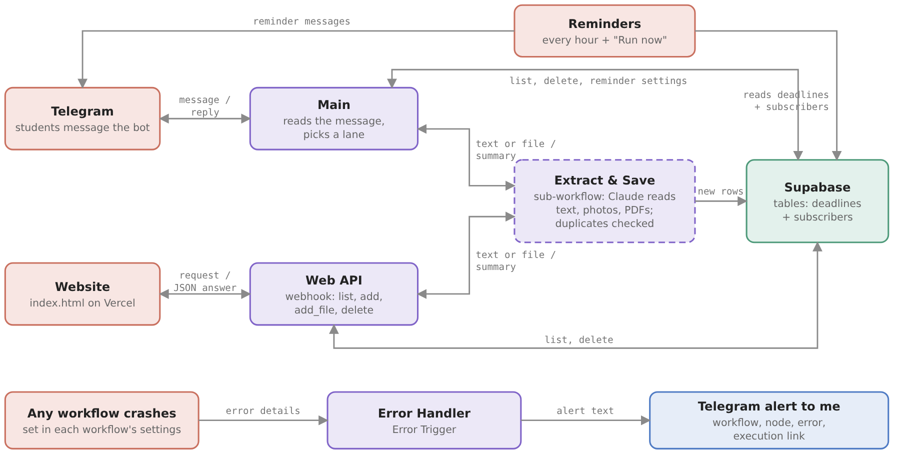
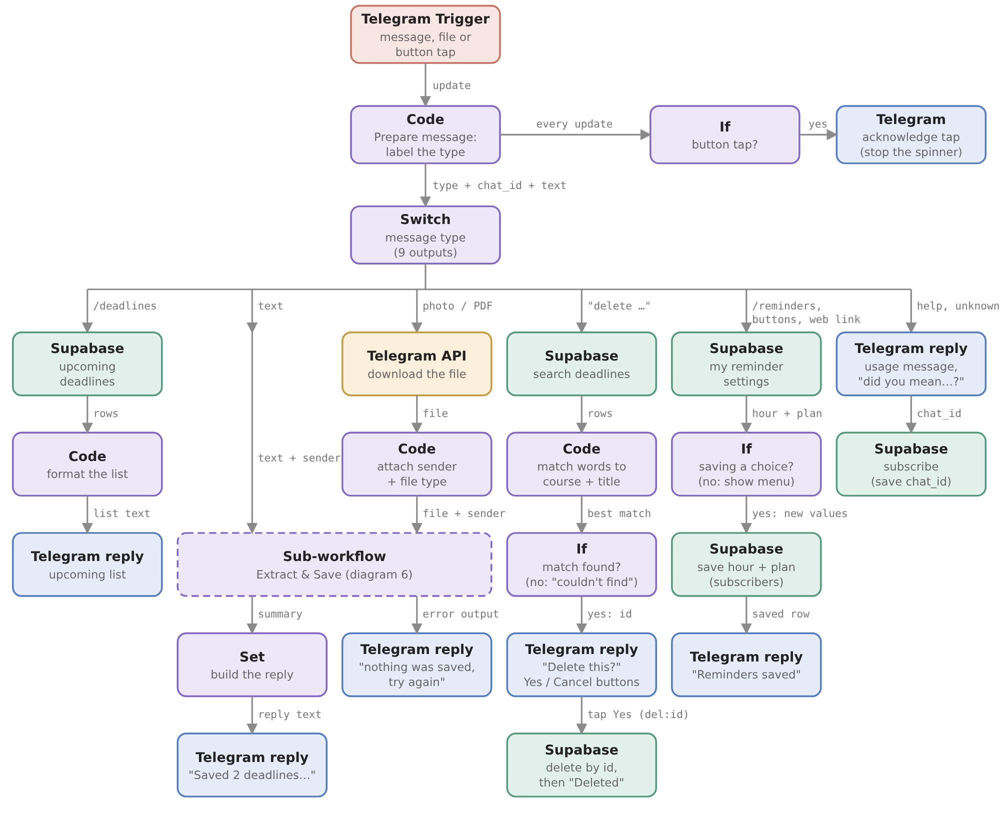
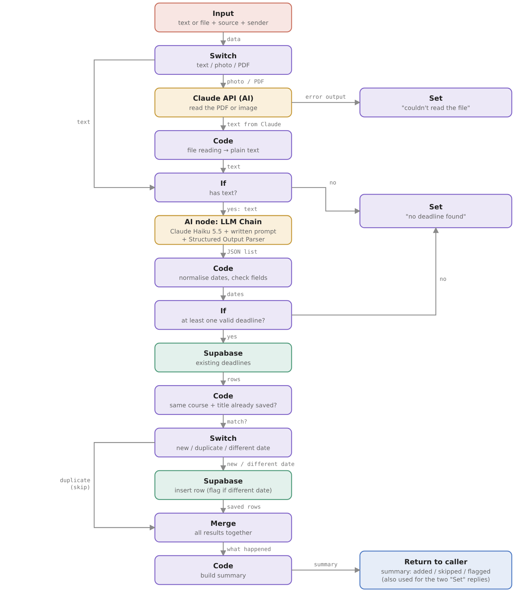
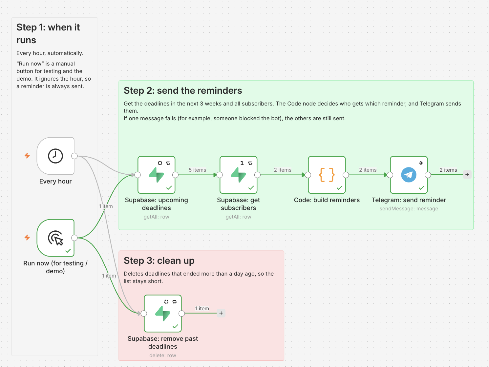
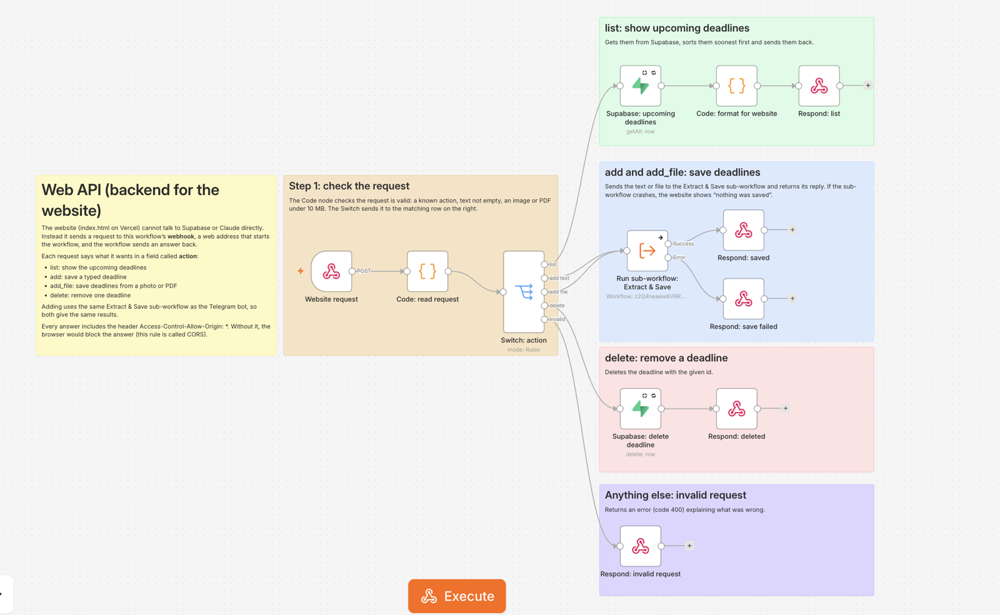
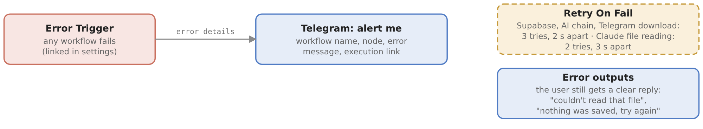

# Deadline Bot

A shared deadline planner for our class. Students add deadlines in plain words, or by sending a photo or PDF of a syllabus, and the bot saves them and reminds everyone before they are due.

It works in two places:

- **Telegram bot:** [@Charlotte_deadline_bot](https://t.me/Charlotte_deadline_bot)
- **Website:** this repository, hosted on Vercel, [deadline-helper-theta.vercel.app](https://deadline-helper-theta.vercel.app)

Both use the same database, so a deadline added on one appears on the other.

Built with n8n for the No-Code Software Development course.

## What it can do

- Save a deadline written in plain words, for example "Data Viz report due 24/10 at 23:59"
- Read a photo or PDF (syllabus, slide, screenshot) and save every deadline in it
- Notice when a deadline is already saved, or saved with a different date
- Show the list of upcoming deadlines (`/deadlines`)
- Delete a deadline in plain words ("delete the Data Viz report"), with a Yes / Cancel check
- Send reminders on Telegram at the time and frequency each person chooses (`/reminders`)
- Remove deadlines automatically once they are over
- Send me an alert on Telegram if a workflow crashes

## How the pieces fit together



```
Telegram  ──►  Main workflow  ──┐
                                ├──►  Extract & Save (sub-workflow)  ──►  Supabase
Website   ──►  Web API workflow ┘            (uses Claude)

Reminders workflow (every hour)  ──►  reads Supabase  ──►  sends Telegram messages

Error Handler  ◄──  runs automatically if any of the workflows above crashes
```

- **n8n** runs the five workflows.
- **Supabase** is the database. It has two tables: `deadlines` and `subscribers`.
- **Claude** (Anthropic) reads photos and PDFs and turns messages into structured deadlines.
- **Vercel** hosts the website (`index.html`).

## The five workflows

The workflow files are in the `n8n/` folder. Each workflow also has notes on its canvas that explain every step, so importing a file is the easiest way to see it in detail.

### 1. Main (the Telegram bot)




Every message or button tap sent to the bot starts this workflow.

1. **Telegram Trigger** receives the message.
2. **Prepare message** (Code) works out what the person wants and gives the message a label, such as "text", "file" or "deadlines".
3. **Switch: message type** sends the message to one of five lanes:
   - Lane 1: show the deadline list
   - Lane 2: add a deadline (text, photo or PDF), using the Extract & Save sub-workflow
   - Lane 3: delete a deadline
   - Lane 4: reminder settings
   - Lane 5: help and anything else
4. Each lane ends with a Telegram message back to the person.

When someone taps a button, a small side branch ("If: button tap?") also tells Telegram the tap was received, so the button does not keep loading.

### 2. Extract & Save Deadlines (sub-workflow)




A sub-workflow is a workflow that other workflows call, like a shared function. Both the bot and the website use this one, so the logic exists only once.

1. Check what arrived: text, a photo or a PDF.
2. For a photo or PDF, Claude reads the file and writes out the deadlines as text.
3. Claude, with a Structured Output Parser, turns the text into a list of course, title, date and time.
4. A Code node checks the dates, uses 23:59 when no time is given, and skips deadlines that are already over.
5. Each deadline is compared with the ones already saved. New ones are saved, duplicates are skipped, and a different date for the same deadline is saved with a conflict warning.
6. One reply sums up what happened.

### 3. Reminders




Runs every hour (Paris time). For each subscriber, if it is the hour they chose and a deadline is exactly one of their plan's days away, they get a reminder.

| Plan | Reminders (days before the deadline) |
|---|---|
| chill | 1 |
| normal (default) | 2, 1 |
| planner | 7, 3, 1 |
| early | 14, 7, 3 |
| intense | 21, 14, 7, 3, 2, 1 |
| countdown | 21, then every day from 14 |
| off | none |

The same workflow also deletes deadlines that ended more than a day ago.

### 4. Web API (backend for the website)




The website cannot talk to Supabase or Claude directly, so it sends requests to this workflow's webhook. Each request has an `action`:

| Action | What happens |
|---|---|
| `list` | returns the upcoming deadlines |
| `add` | saves a typed deadline (through Extract & Save) |
| `add_file` | saves deadlines from a photo or PDF (through Extract & Save) |
| `delete` | deletes one deadline by id |

Anything else gets an error message back.

### 5. Error Handler




The other four workflows are linked to this one in their settings (Settings, then Error workflow). If one of them crashes, n8n runs it automatically and sends me a Telegram message with the workflow, the node and the error.

## Error handling

There are three layers:

1. **Retry On Fail.** Supabase and Claude nodes, and some Telegram nodes, try again (2 or 3 times) before giving up.
2. **Error outputs.** Where a failure is expected, for example Claude being busy, the workflow follows an "Error" path and the person gets a clear message instead of silence.
3. **Error Handler workflow.** Anything not caught by the first two sends me an alert.

## Reminder settings from the website

The website does not save reminder settings itself, because it does not know who you are on Telegram. Instead:

1. You choose a time and a plan on the website. It puts them in the link of the "Send me reminders on Telegram" button, for example `https://t.me/Charlotte_deadline_bot?start=r_18_planner` (18:00, planner plan).
2. You open the link and tap Start. Telegram sends the bot the message `/start r_18_planner`.
3. The Main workflow reads it and saves the settings for your chat.

## Environment variables and keys

No key is stored in this repository. `.env.example` lists everything you need; copy it to `.env` and fill it in. On n8n Cloud the keys are entered once in n8n under **Credentials** instead of a file.

| Name | What it is | Where to get it |
|---|---|---|
| `TELEGRAM_BOT_TOKEN` | the bot's token | [@BotFather](https://t.me/BotFather), `/mybots`, API Token |
| `SUPABASE_URL` | your Supabase project address | Supabase, Project Settings, API |
| `SUPABASE_SERVICE_ROLE_KEY` | key that lets n8n read and write the tables | Supabase, Project Settings, API |
| `ANTHROPIC_API_KEY` | key for Claude | console.anthropic.com, API Keys |
| `ALERT_CHAT_ID` | your Telegram chat id, where error alerts go | send a message to the bot and look at the chat id in the execution |
| `N8N_ENCRYPTION_KEY` | self-hosting only: encrypts the stored credentials | any long random string; keep it, or saved credentials can't be read |
| `GENERIC_TIMEZONE`, `TZ` | `Europe/Paris`, so reminders use Paris time | |
| `WEBHOOK_URL` | self-hosting only: the public address of n8n, so Telegram and the website can reach it | your tunnel or server address |

The website has two settings at the top of the script in `index.html`: `API` (the Web API webhook address) and `BOT` (the bot's username).

## How to test

Send these to the bot after every change. Each one checks one part of the system.

| Send | Expected result |
|---|---|
| `Data Viz report due 24/10 at 23:59` | "Saved 1 deadline", with the course, title and date |
| `the essay is due next Friday` | "next Friday" becomes a real date; a missing course is handled |
| the same message a second time | "already recorded", no second row in Supabase |
| `hello` | "no deadline found", nothing saved |
| `/deadline` (typo) | "Did you mean /deadlines?" and the usage message |
| `/deadlines` | the list, including what you just saved |
| `delete the Data Viz report` | "Delete this deadline?" with Yes / Cancel; Yes deletes it |
| a photo of a slide, or a PDF syllabus | every deadline in the file is saved |
| a text file renamed `fake.pdf` | "I couldn't read that file" (error path) |
| `/reminders` | menu to choose a time and a plan |

To test reminders without waiting for the hour, open the Reminders workflow and run it from **Run now (for testing / demo)**. It ignores the hour, so anyone with a deadline on one of their plan's days gets a message.

To test the website, open it, add a deadline, then send `/deadlines` to the bot: the same deadline is there.

Then check the **Executions** tab in n8n: recent runs should be green.

## Files in this repository

| File | What it is |
|---|---|
| `index.html` | the website (one page, no build step) |
| `vercel.json` | Vercel setting for clean URLs |
| `n8n/*.json` | the five n8n workflows |
| `supabase/schema.sql` | the database tables |
| `docs/` | workflow diagrams and screenshots |
| `.env.example` | the keys and settings you need (copy to `.env`, never commit it) |
| `.gitignore` | keeps `.env` and local n8n data out of Git |

## Running it yourself

### 1. Database (Supabase)

Create the two tables by running `supabase/schema.sql` in your Supabase SQL Editor.

### 2. n8n

1. Create a Telegram bot with [@BotFather](https://t.me/BotFather) and keep its token.
2. In n8n, import each file from `n8n/` (Workflows, then Import from file). Import `extract-and-save.json` and `error-handler.json` first, because the others point to them.
3. Add your own credentials: Telegram (bot token), Supabase (project URL and service key) and Anthropic. The files do not contain any keys.
4. In Main and Web API, check that "Run sub-workflow: Extract & Save" points to your imported Extract & Save workflow.
5. In each workflow's settings, set the Error workflow to your imported Error Handler.
6. In Error Handler, change the chat id in "Telegram: alert me" to your own.
7. Publish all five workflows.

### 3. Website

1. In `index.html`, change `API` (the address of your Web API webhook) and `BOT` (your bot's username) near the top of the script.
2. Deploy the repository on Vercel. `index.html` must be at the root of the repository.
